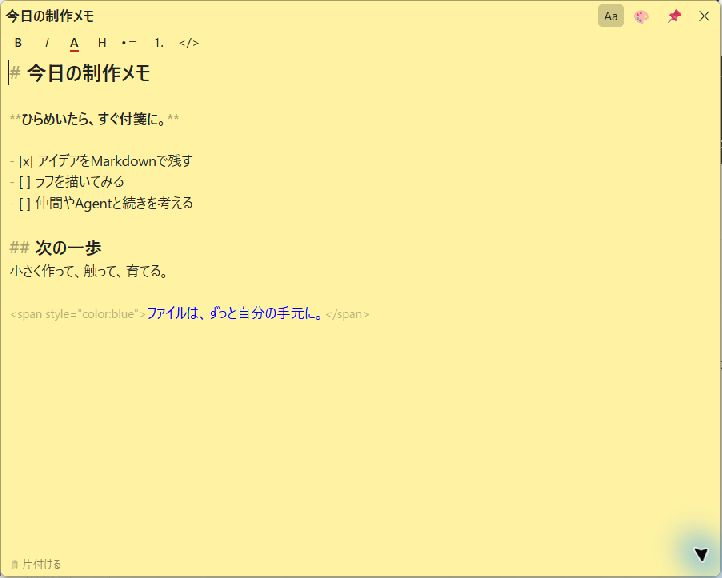
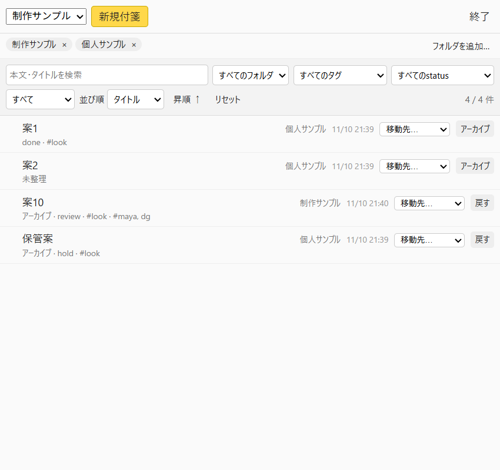

# Markdown Sticky Notes


Windows向けの、普通のMarkdownファイルを使うデスクトップ付箋アプリです。付箋を1枚ずつ開いて編集でき、人間もAgentも同じファイルを扱えます。アカウントや専用同期サーバーは不要です。

**作業中のアプリについてくる付箋**です。安定版`0.3.1`でWindowsのウィンドウ追従とChrome／VS Code拡張による既存タブへのリンクを使えます。[実装の方針](docs/CONTEXT_NOTES.md)を参照してください。

現在は初期版です。重要なメモはフォルダごとバックアップしてください。

[安定版Windows x64をダウンロード](https://github.com/hogawish/markdown-sticky-notes/releases/latest)（未署名のインストーラー）

更新はGitHub Releasesで確認します。配布物のソースはReleaseと同じ名前のGitタグから取得でき、Windowsで下記のビルド手順を実行できます。ダウンロードしたファイルは `Get-FileHash -Algorithm SHA256 -LiteralPath <ダウンロードしたファイル>` で計算し、Releaseに記載された値と照合してください。SHA-256は配布ファイルとの一致を確認するための値です。

## 画面



Windows上で実際に起動した付箋画面です。撮影用のサンプルメモを表示しています。



`0.2.0`の一覧画面です。サンプルのみを使い、アーカイブを含む表示にしています。

## できること

- 複数のメモフォルダを登録し、一覧から付箋を開く
- 枠なしウィンドウの移動・リサイズ、色変更、前面固定
- 本文上のCtrl＋スクロールで文字サイズ変更、Ctrl＋0で標準へ戻す
- Markdownの直接編集、書式ショートカット、`/`による書式選択
- ドラッグハンドルの隣の✎でタイトル編集。Enterで保存、Escで中止。空欄なら本文の先頭行を使用
- 付箋の「📂 場所」からExplorerでそのファイルを選択。一覧の📂から登録フォルダを開く
- ライブプレビュー: カーソルのない行ではMarkdownの記号を隠して整形して見せ、カーソルのある行だけ記号を出します（太字・見出し・箇条書き・引用・リンク・コード・区切り線・文字色）。`- [ ]`は本物のチェックボックスになり、クリックで`[ ]`と`[x]`を入れ替えます。付箋の▾メニューの「Markdownの記号を常に表示」で、原文のまま表示することもできます
- `@today`、`@tomorrow`、`@now`などの日時挿入
- HTTP/HTTPSのURLをCtrl+クリックで開く
- 自動保存と外部変更の読込、変更が重なったときの選択
- 完全削除せず、同じフォルダの`.trash`へ片付ける
- タスクトレイから一覧・新規付箋・終了（一覧は、付箋の▾メニューの「📋 付箋の一覧を開く」からも開けます）
- トグル: 行左の ⋮⋮ から「トグル」を選ぶか、`/toggle` を使います。子のリスト行は Tab で字下げし、トグルの ▾ / ▸ で開閉します。種類は Markdown の `- [>] 見出し` として保存します。
- ショートカットとコマンドの一覧を、付箋の▾メニューの「⌨ ショートカット一覧」から、別の窓で開く（同じ内容が[shortcuts.md](shortcuts.md)にあります）
- フォルダ・タグ・status・本文検索の組み合わせによる絞り込み
- 更新日時・作成日時・タイトル・フォルダの並び替えと昇順／降順の切替
- frontmatterでのアーカイブと復元、登録フォルダ間の移動

## アプリについてくる付箋

1. 付箋の上部にある🔗を押し、次に作業先のウィンドウをクリックして貼り付けます。Escで中止できます。
2. 貼付先のウィンドウに切り替えると付箋が出ます。付箋をドラッグして位置を調整できます。貼付中の付箋をクリックすると、貼付先もその後ろへ前面表示します。
3. 貼付先の移動・リサイズに追従します。📌OFFは貼付先のすぐ上に重なり、別アプリが上に来るとその下に隠れます。📌ONは常に最前面です。貼付先を最小化しても、ONなら最後の位置に残り、OFFなら一緒に隠れます。
4. 貼付中は🔗が青く強調されます。押すと「外す？」になり、3秒以内にもう一度押すとデスクトップへ戻します。Escや時間経過で取り消せます。Shift+クリックは貼付先変更、▾で下部のタグと貼付先の表示を切り替えます。メニュー外をクリックすると閉じます。貼付先を閉じたときも本文は残ります。

Chrome／VS Code拡張を接続した場合、▾ →「タブリンク設定…」の「選んだタブをリンク」で参照を保存し、付箋上部の↗でその既存タブに戻れます。ウィンドウ追従とは独立した設定です。タブを切り替えても付箋の表示状態は変わりません。[導入手順・必要な権限](extensions/README.md)を参照してください。貼付先・相対位置・タブのリンクはPC側の`config.json`に保存し、Markdown本文は変更しません。対象アプリ再起動後は再接続・リンク設定を行ってください。

初期実装は約120msごとにWindowsのウィンドウ位置と最小化状態を確認します。画面撮影、ページ本文・キー入力の取得、外部アプリへのDLL注入、Agentの呼出しは使いません。専用Win32試験ウィンドウで移動・リサイズ・最小化・復帰・編集保存・解除・対象終了を確認しています。各アプリ固有のダイアログ、仮想デスクトップ、混在DPI等は実利用のFBで調整します。

## 一覧とfrontmatter

タグは付箋の下部、または一覧の各行にある「タグ」から編集できます。タグ・status・作成日時は、メモ先頭のYAML frontmatterから読みます。既存のメモにもそのまま使えます。

```markdown
---
id: my-stable-note
tags: [animation, review]
status: in_progress
created: '2026-11-10T10:30:00+09:00'
archived: false
---
# 今日の制作メモ
ここから本文です。
```

タグは文字列の配列（複数行のYAML配列も可）、statusは任意の文字列です。必須ではなく、項目がないメモは「未整理」として表示・絞り込みできます。候補は既存ファイルから自動的に拾います。本文検索はタイトル・本文・タグ等を対象にします。

作成日時は`created`を優先し、ない場合はファイルの作成日時を使用します。更新日時の並び替えは実ファイルの更新日時を使うため、外部Agentによる変更も反映されます。表示条件と並び順はそのPCのローカル設定に保存します。statusを変更するには、Markdownファイルのfrontmatterを編集してください。

### アーカイブ

付箋の「アーカイブ」または一覧の行ボタンで`archived: true`にします。ファイルは動かさず、元のstatus・id・本文・未知のキーを保持します。通常の一覧では隠れ、「アーカイブのみ」や「すべて」で表示して「戻す」を押せます。`archived: false`にすると通常の一覧へ戻ります。`.trash`へ移す削除とは独立しています。

### フォルダ移動

一覧の各行の「移動先…」から、別の登録済みフォルダへ移動できます。開いている付箋は入力を保存してから移動し、その窓を閉じます。本文・frontmatter・ファイル名はそのままです。同名ファイルは上書きしません。配置設定も移動先へ引き継ぎます。

別ドライブも扱えるように、移動先への書込と内容確認が終わってから元ファイルを片付けます。電源断や共有先の障害があれば両方に残る場合があります。ファイルパスは変わるため、絶対パスで参照していた外部のリンクは移動先に合わせてください。

## Agentやスクリプトからの操作（コマンドライン）

動いているアプリを止めずに、付箋の窓を外から開く・動かす・前面に固定する・閉じることができます。付箋の中身は、これまでどおり`.md`を書き換えます。

```powershell
& "<app.exe>" open  "<付箋のパス>" --monitor 2 --anchor top-left --pin
& "<app.exe>" close "<付箋のパス>"
```

`app.exe`の場所は、`%APPDATA%\io.github.hogawish.stickynotes\tab-host.json`の`executable`に記録されています。2つ目の起動は、引数を動いているアプリへ渡して、すぐ終了します。アプリが動いていなければ、その引数で起動して実行します。

### open

| 引数 | 意味 |
|---|---|
| `<path>` | 付箋のファイル（登録フォルダの直下の`.md`）。相対パスは、コマンドを実行したフォルダからの位置 |
| `--create` | ファイルが無ければ、空で作る（登録フォルダの中だけ） |
| `--monitor primary\|N` | 置くモニター。Nは左から順に1、2、…（左端が同じなら上から）。OSの番号とは別です |
| `--anchor top-left\|top-right\|bottom-left\|bottom-right\|center` | モニターの作業領域（タスクバーを除いた範囲）の隅。`--monitor`だけなら`top-left`、`--anchor`だけなら`primary`になります |
| `--margin PX` | 隅からの余白（論理px、既定16） |
| `--x X --y Y` | 見えている窓の左上を、画面全体の座標（物理px）で指定。`--monitor`などとは同時に指定できません |
| `--width W --height H` | 見えている窓の大きさ（論理px、最小160×100） |
| `--pin` / `--no-pin` | 前面固定のオン／オフ。指定しなければ変えません |
| `--focus` | 窓にフォーカスを渡す。既定では、作業中の窓からフォーカスを奪いません |
| `--result FILE.json` | 結果を書き出すファイル（`.json`のみ） |

すでに開いている付箋への`open`は、その窓を動かします。位置・大きさを指定しなければ動かしません。開いていなければ開きます（位置の指定がなければ、前回の位置）。

### close

保存してから閉じるように要求します。保存できないときは、付箋の画面で編集に戻るか、保存せず閉じるかを選べます。

### 結果ファイル

`--result`を付けると、成否をJSONで書き出します。成功は`{"ok": true, "path": …, "pin": …, "x": …, "y": …, "width": …, "height": …, "monitor": 2, "monitors": 2}`（位置と大きさは見えている窓の物理px）、失敗は`{"ok": false, "error": "…"}`です。`close`は`state`に`close-requested`か`not-open`を返します。コマンド自体は、結果を待たずに終了するので、確かめたいときはこのファイルを読んでください。

### 制限

- 登録フォルダの外の付箋は、扱えません。
- 他のアプリの窓に貼り付けている付箋は、位置と前面固定を外から変えられません。
- 位置・大きさ・前面固定・開閉は、これまでどおり、このPCの`config.json`に保存します。付箋のファイルには書きません。
- 入力中の文字には触れません。ブラウザ拡張用の`--tab-host`とは別のものです。

## 保存場所

既定のメモフォルダは`%USERPROFILE%\Documents\StickyNotes`です。一覧の「フォルダを追加…」から、別のローカルフォルダや共有フォルダを登録できます。

1付箋は1つのUTF-8 Markdownファイルです。本文編集では既存のfrontmatter、UTF-8 BOM、本文の改行形式を保持します。改行が混在する本文を編集した場合は、先頭の改行形式で揃えます。タイトルはfrontmatterの`title`を使い、省略すると本文の最初の空でない行を使います。付箋は4 MiBまで、frontmatterは64 KiB・32階層までです。エイリアスを含むYAMLは属性として読み込めません。

既定では、`%APPDATA%\io.github.hogawish.stickynotes`の`config.json`にファイルパス、配置、貼付先のウィンドウ題名、保存したタブの題名が平文で残ります。タブ連携中は`tab-contexts`の状態ファイルにも題名などが入ります。WebView2のローカルストレージには一覧の検索語・絞り込み条件や、折りたたんだ行のテキスト（本文の一部）が残ります。

設定で暗号化は行いません。登録フォルダのファイルを読める人やAgentは、メモを読めます。共有範囲はOSや共有フォルダ側の権限で管理してください。

## 保存と共有

入力が止まって約600msで保存し、外部の更新を約1秒間隔で確認します。保存中に追記した文字は、先の保存が終わった後に続けて保存します。保存に失敗・競合したときは入力を残し、片付ける操作を中断します。

一覧やトレイからの終了も、付箋ごとの保存と終了処理を通ります。保存できない付箋は「編集に戻る」か「保存せず閉じる」を選べます。正常終了では、開いていた付箋を次回起動で復元します。Windowsの強制終了・電源断・プロセス強制停止では、まだ保存されていない文字は失われ得ます。

外部変更の比較には本文とfrontmatterを含むファイル全体のSHA-256を使います。読込時点から変わっていれば競合として表示します。同一アプリ内の書込は直列化し、一意な一時ファイルから置換します。

**複数PCや外部Agentとの同時編集に対する、分散ロックや原子的な比較更新はありません。** 最後の確認と置換のわずかな間に外部が保存する競合は残ります。同じメモを同時に編集せず、担当を分けて運用してください。ネットワーク共有の可用性や性能も共有先に依存します。

開いている付箋の入力を消さないため、そのフォルダを登録から外す前に該当する付箋を閉じてください。フォルダ登録を外してもメモファイルは削除しません。不正UTF-8のファイルは自動変換せず、エラーとして開く処理を停止します。

## 開発環境とビルド

Windows、Node.js 22.12以降の対応版（検証は24.22.1）、Rust stable、Visual StudioのC++ Build ToolsとWindows SDK、WebView2が必要です。Tauriの[Windows向け前提条件](https://v2.tauri.app/start/prerequisites/#windows)を参照してください。

PowerShellでリポジトリ直下から実行します。

```powershell
cd app
npm ci
npm test
npm run build
cd src-tauri
cargo test --locked --lib
cd ..
npm run tauri -- build
```

開発時も先に`npm run build`してから`npm run tauri -- dev`で起動できます。HMR用の開発サーバーは設定していません。

検証には`STICKY_DIR`（既定のメモフォルダ）、`STICKY_CONFIG_DIR`（設定フォルダ）を指定できます。初回の空設定で使用します。`STICKY_NO_SINGLE=1`は単一起動の検査を無効にします。テスト用には専用のメモ・設定フォルダを指定してください。

```powershell
$env:STICKY_DIR = "$PWD\scratch\notes"
$env:STICKY_CONFIG_DIR = "$PWD\scratch\config"
$env:STICKY_NO_SINGLE = "1"
npm run tauri -- dev
```

独自アイコンの編集元は`app/src-tauri/icons/source.svg`です。`app`内で`npm run tauri -- icon src-tauri/icons/source.svg`を実行すると配布用サイズを再生成できます。

## 検証範囲

WindowsのCIでフロントのビルド、JS回帰テスト、Rust単体テストを実行します。JS回帰テストは一覧選択処理とDOM・IPCの模擬環境を使います。専用プロファイルのChrome／VS Code拡張を使い、Native Messaging経由で既存のタブへ戻る操作も確認しています。

実際のTauri/WebView画面でも、サンプルの組み合わせ絞り込み、並び替え、アーカイブ・復元、開いている付箋の下書き保存、登録フォルダ間移動を確認しました。すべてのGUI操作、IME、DPI構成、ネットワークドライブの実機動作を保証するものではありません。

## ライセンス

自作コードと独自アイコンは[MIT License](LICENSE)です。依存ライブラリや初期テンプレートの権利は、それぞれの作者に帰属します。[第三者ライセンスとソース取得先](THIRD_PARTY_NOTICES.md)を参照してください。

Windows、Microsoft、Tauri等は各権利者の商標です。本アプリは各社・各プロジェクトの公式製品ではありません。

## バージョン

不具合修正にはパッチ番号、機能追加にはマイナー番号を使います。基本仕様が固まった版を`1.0.0`とし、保存形式に互換性のない変更がある場合は変更履歴で明示します。

アプリ設定・Cargo・npmのバージョンを揃え、公開する区切りでは`v0.1.0`形式のGitタグと[GitHub Release](https://github.com/hogawish/markdown-sticky-notes/releases)を作ります。[変更履歴](CHANGELOG.md)も参照してください。
